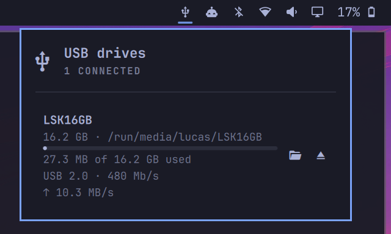

# USB Drives for Omarchy



A small bar widget for [Omarchy](https://omarchy.org) that appears while a USB
stick, SD card or external drive is plugged in. Click it to see each drive and
eject it safely.

For each drive, the popup shows:

- its name, size and where it is mounted
- how full it is, as a bar and as numbers ("3.2 GB of 16.2 GB used")
- the USB connection it is using, e.g. `USB 2.0 · 480 Mb/s`. This catches a
  USB 3 stick stuck in a slow port or cable.
- live read and write speed while you copy files
- which programs are keeping it busy when it can't be ejected yet ("In use by
  nautilus, vim"), updating as you close them

**Open** opens a drive in your file manager, mounting it first if needed.
Encrypted drives are unlocked with a passphrase prompt. **Eject** unmounts
every partition, locks encrypted volumes and powers the drive off, then
tells you it is safe to remove.

The drive Omarchy itself is running from is never listed and can never be
ejected. That is the case when Omarchy runs from a USB stick, installed
there or as the live installer.

## Install

Requires Omarchy 4 (Quattro).

```sh
omarchy plugin add https://github.com/lucaskup/omarchy-usb-drives.git --enable
```

The widget is added to the right side of the bar. Move it with
`omarchy bar move lucaskup.usb-drives --section left|center|right`, or drag
it on the bar.

## Remove

```sh
omarchy plugin remove lucaskup.usb-drives
```

This deletes the plugin and takes it off the bar. It stores nothing
elsewhere. To keep it installed but hidden, use
`omarchy plugin disable lucaskup.usb-drives` instead.

## Dependencies

All of these come with a standard Omarchy install. The plugin checks for them
at startup and says which package is missing if one is not installed.

| Tool | Package | Used for |
|---|---|---|
| `udisksctl` | udisks2 | mount, unmount, lock, power off, watching for drives |
| `udiskie-mount` | udiskie | mounting and unlocking encrypted drives on Open (optional: without it, plain drives still mount but encrypted ones can't be unlocked) |
| `lsblk` | util-linux | listing drives and partitions |
| `fuser` | psmisc | naming programs that keep a drive busy (optional) |
| `notify-send` | libnotify | notifications (optional) |
| `xdg-open` | xdg-utils | opening the file manager |

Nothing runs as root and nothing asks for your password. udisks lets the
logged-in user mount and eject removable drives.

## Using it

| On the bar icon | |
|---|---|
| Left-click | open or close the popup |
| Right-click | open the first drive in the file manager |
| Middle-click | eject the drive, when only one is plugged in |

| In the popup | |
|---|---|
| ↑ / ↓ | pick a drive |
| Enter | open it |
| Delete | eject it |
| Esc | close |

## Settings

Change these in Omarchy's widget settings, or in `~/.config/omarchy/shell.json`
on the widget's entry, e.g.
`omarchy bar set lucaskup.usb-drives showUsageOnBar true --json`.

| Setting | Default | |
|---|---|---|
| `showUsageOnBar` | `false` | Show how full the fullest drive is next to the icon ("42%") |
| `showConnection` | `true` | Show the USB version and link speed |
| `showTransferSpeed` | `true` | Show live read/write speed while the popup is open |
| `notifyOnEject` | `true` | Show "Safe to remove" after ejecting. Errors are always shown. |

## Known limitations

- **LVM inside an encrypted drive** is not supported. Eject will fail at
  the power-off step.
- **SD card readers built into the laptop** (`mmcblk*`) don't report a
  connection speed, so that line is left out. USB card readers work.
- **Mounting is left to udiskie**, Omarchy's automounter. The plugin only
  mounts on Open.
- **After editing the plugin's files**, run `omarchy restart shell`. The
  shell notices changes to third-party plugins but keeps the old code loaded.

## How it works

| File | |
|---|---|
| `Service.qml` | Runs once for all monitors. It watches `udisksctl monitor` and runs the scripts. |
| `Panel.qml` | The bar icon and popup. It draws and forwards clicks, nothing else. |
| `Model.js` | All parsing and decisions as pure functions, tested outside the shell |
| `scripts/` | `list.sh`, `stat.sh`, `holders.sh`, `deps.sh`, `open.sh`, `eject.sh` |

Commands are always run as argument lists, never assembled into shell
strings.

## Development

Tests need Node.js 22.8 or newer. The plugin itself does not use Node.

```sh
npm test                    # unit, script and consistency tests
npm run test:coverage       # same, fails below 100% coverage of Model.js
npm run test:integration    # real udisks on throwaway loop devices
```

See [`tests/README.md`](tests/README.md) for what each suite covers.

## License

[MIT](LICENSE)
